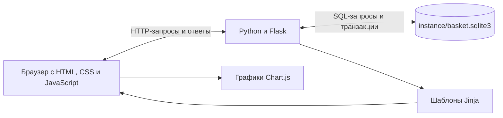

# Корзина

Локальное приложение для анализа стоимости потребительской корзины. HTML, CSS, JavaScript, Python + Flask и SQLite. Интерфейс на русском с фиолетовыми акцентами, интерактивными графиками и переносом всех данных через CSV, XLSX и JSON.

Новая версия содержит раздел «Перенос данных», шаблоны файлов и видимый справочник всех продуктов. Повторное добавление существующего продукта с той же единицей больше не вызывает ошибку.

## Быстрый запуск двойным щелчком — Windows

Распакуйте ZIP в обычную папку и дважды щёлкните **START_WINDOWS.bat**. Вводить команды в терминал и заранее устанавливать Python вручную не требуется. Можно создать ярлык этого файла на рабочем столе. Способ предназначен для Windows 10/11.

Батник вызывает `SETUP_WINDOWS.ps1`, который проверяет настоящую версию интерпретатора. Подходят стабильные CPython **3.12, 3.13 и 3.14** со стандартными модулями. Если такая версия уже установлена, она используется без повторной установки. Наличие одной команды `python` ещё не считается проверкой: ярлык Microsoft Store пропускается, установки ищутся также в реестре, стандартных папках и списке Python Launcher.

Если подходящего Python нет, помощник устанавливает **Python 3.14 для текущего пользователя** через WinGet. Если WinGet отсутствует, скачивает последний стабильный установщик ветки 3.14 с **python.org**, проверяет подпись **Python Software Foundation** и запускает установку. Уже установленная неподходящая версия Python не удаляется. После установки запуск продолжается автоматически в том же окне. При отмене установки или ошибке сайт не запускается; прочитайте сообщение и повторите запуск позже. Если Windows запросит разрешение или перезагрузку, подтвердите разрешённую установку или перезагрузите компьютер.

При первом запуске помощник автоматически создаст окружение `.venv`, установит библиотеки и откроет сайт в вашем браузере. Интернет потребуется для первой установки библиотек. При следующих запусках подготовленные библиотеки используются повторно. После обновления `requirements.txt` помощник сам установит нужные версии.

Откроется небольшое окно сервера. Его можно свернуть и работать с сайтом в браузере. Для завершения работы нажмите **Ctrl+C** в этом окне. Данные сохраняются автоматически. Если приложение из этой же папки уже работает, повторный запуск открывает его страницу в браузере.

Если порт 5000 занят другой программой или старой копией приложения, помощник автоматически выбирает свободный порт и открывает правильный адрес. При повторном запуске он находит уже работающую копию этой папки.

### Отдельная установка Python перед первым запуском

При желании дважды щёлкните **INSTALL_PYTHON.bat**. Он только проверяет или устанавливает Python. Сайт и установка библиотек приложения в этом режиме не запускаются. После сообщения о готовности закройте окно и откройте **START_WINDOWS.bat**. Это дополнительный способ подготовки — обычный файл запуска выполняет ту же проверку сам.

### Перенос на другой компьютер

Для первого запуска без Python и для установки библиотек нужен интернет. После успешной подготовки приложение может работать без интернета: графики и шрифты находятся в проекте. Автоустановка требует доступа к WinGet или python.org и серверам пакетов Python. Если сеть или правила компьютера запрещают установку, помощник покажет ошибку и адрес для ручной установки.

Переносите код и папку **instance**, предварительно остановив сервер. **.venv** переносить не требуется. Если скопированное окружение не запускается, имеет неподходящую версию или не содержит pip, помощник сохранит его в `.venv-backup-ДАТА-НОМЕР`, а при запуске сайта создаст новое. Папка **instance** с базой при этом не изменяется. После проверки новой версии старую резервную папку окружения можно удалить через Проводник.

Сохраняйте `START_WINDOWS.bat`, `INSTALL_PYTHON.bat` и `SETUP_WINDOWS.ps1` вместе с остальными файлами проекта. PowerShell вызывается автоматически с параметрами только для этого процесса; команды вручную и постоянное изменение системной политики выполнения не требуются.

Ручные команды из инструкции ниже остаются дополнительным способом запуска и диагностики.

## Три магазина рядом с составом корзины

В разделе **«Мои корзины»** рядом с количеством каждого продукта теперь есть три столбца магазинов.

1. Откройте нужную корзину.
2. В поле «Цены на дату» задайте день, на который хотите сравнить цены. Начальное значение — самая поздняя дата в истории цен.
3. В заголовках столбцов «Магазин 1», «Магазин 2», «Магазин 3» выберите до трёх разных магазинов. Любой столбец можно оставить в состоянии «Не выбран».
4. Цены и суммы обновятся автоматически. При недоступности автоматического обновления появляется кнопка «Показать цены» для обычной загрузки страницы.
5. В строке продукта показано количество × цена за единицу, единица измерения и стоимость позиции. Например, 3 кг по 58,85 ₽ дают 176,55 ₽. Минимальная известная цена по продукту выделена цветом темы.
6. Внизу каждого столбца показана сумма корзины в этом магазине. При пропущенных ценах указан итог известных позиций и число пропусков. Если ни одной цены нет, отображается прочерк.
7. Под таблицей отдельно показана **«Корзина по минимальным ценам»**. Для каждого продукта выбирается минимальная известная цена среди выбранных магазинов и применяется количество из корзины. Это помогает оценить покупки в разных магазинах. Если для продукта нет цены ни в одном выбранном магазине, общий итог помечен как неполный и перечисляет пропуски.

Выбор магазинов и даты сохраняется в адресе страницы и переносится при добавлении, изменении количества и удалении позиции. Эти настройки относятся к просмотру и расчётам. Импорт и экспорт содержат бизнес-данные корзин и цен.

Для примера `examples/basket-data.json` на 01.11.2026 столбцы показывают «Лавка» — 1 819,00 ₽, «Маркет» — 1 938,00 ₽, «Дискаунтер» — 1 449,60 ₽ известных позиций. При покупке каждого продукта по минимальной цене среди трёх магазинов получается **1 652,90 ₽**. Молоко берётся по цене «Лавки», остальные продукты — по цене «Дискаунтера».

На узком экране таблица прокручивается горизонтально. Все денежные суммы рассчитывает сервер через Decimal, итог округляется до копеек после суммирования.

## Динамика неполных корзин

«Дискаунтер» в примере имеет цены девяти продуктов и пропуск молока. В динамике теперь показывается его известная сумма, как и на главном экране. В легенде появляется отметка «известные позиции», а подсказка каждой точки показывает отсутствующие цены.

В таблице динамики начальная и конечная известные суммы также видны. Изменение суммы и процент рассчитываются при наличии всех цен на обе даты. При полностью отсутствующих ценах на дату на графике остаётся пропуск. Рейтинг самой выгодной полной корзины учитывает полноту данных.

## Полная очистка данных приложения

На странице **«Перенос данных»**, внизу, находится блок **«Очистка приложения»** с кнопкой **«Очистить все данные»**.

1. При необходимости сначала скачайте экспорт JSON, CSV или XLSX.
2. Нажмите «Очистить все данные». Откроется предупреждение с перечнем удаляемых данных.
3. Кнопка «Удалить» первые **3 секунды** серая и неактивная. Отсчёт начинается после подготовки подтверждения сервером. После отсчёта кнопка становится неоново-красной.
4. Нажмите «Отмена» или Escape, чтобы закрыть окно. Продукты, магазины и другие бизнес-записи сохранятся. При новом открытии предупреждения отсчёт начинается заново.
5. Для подтверждённой очистки дождитесь окончания отсчёта и нажмите красную кнопку «Удалить». Само окончание таймера ничего не удаляет.

Удаляются все строки таблиц `products`, `stores`, `baskets`, `items`, `prices`, `metadata` текущей рабочей базы SQLite. Операция выполняется одной транзакцией. При ошибке изменения откатываются. На странице появятся нулевые счётчики, справочники и графики получат пустые состояния. После перезапуска база будет пустой до добавления или импорта новых данных.

Сервер также проверяет трёхсекундную задержку, CSRF-токен и срок подтверждения. Подтверждение действует пять минут и теряет силу после выполненной очистки. Старая форма не сможет повторно очистить новые записи.

Файлы экспорта и прежние резервные копии — отдельные файлы на диске. Ими можно восстановить данные после очистки. Для удаления таких файлов используйте Проводник.

Чтобы начать с обычных названий без старых дублей, после подтверждённой очистки импортируйте **`examples/basket-data.json`**. В примере 10 продуктов и 3 магазина с обычными названиями. Повторный импорт того же файла в режиме сохранения существующих значений использует эти же записи. В файлах JSON, CSV и XLSX из папки `examples` отсутствуют пометки «учебный» и добавленные номера `(2)`.

## Если папки instance нет

Папка `instance` появляется автоматически при первом успешном запуске приложения рядом с `app.py`. В ZIP с исходным кодом она отсутствует, потому что создаётся для ваших локальных данных.

Если это первая установка, просто запустите `START_WINDOWS.bat`. Создавать папку или базу вручную не требуется. Если запуск ранее останавливался из-за занятого порта, используйте свежий файл запуска — он сам подберёт свободный порт.

Если вы уже вводили данные в прежней версии, ищите `instance/basket.sqlite3` в той старой распакованной папке, из которой запускался сайт. Можно найти файл `basket.sqlite3` через поиск Проводника. Для переноса старой базы остановите старый сервер и скопируйте его папку `instance` рядом с новым `app.py`. Из программы также можно сделать экспорт и загрузить его в новой версии.

## Почему старые названия могли оставаться в списке

Названия в выпадающем списке берутся из вашей базы SQLite. Файлы в `examples` используются при импорте. В новой версии эти файлы созданы заново с обычными названиями продуктов, магазинов и корзины.

При запуске приложение также обновляет известные названия из ранних версий примеров — например, «Учебный картофель» превращается в «Картофель». Сначала создаётся резервная копия `basket.sqlite3.before-demo-names-XXXXXXXXXX.sqlite3` рядом с базой. Меняются только названия. ID, единицы, количества, даты, цены и связи сохраняются.

Если название «Картофель» уже занято другой записью, переименованный продукт получает свободное имя вроде «Картофель (2)». Это сохраняет обе записи и их собственную историю цен. Такое правило применяется также к совпадающим названиям магазинов и корзин. При повторном запуске уже обработанные записи повторно не переименовываются.

## Исправление ошибки создания продукта на Windows

Причина воспроизведена на базе, созданной при чтении `schema.sql` в Windows-кодировке CP1251. Файл схемы сохранён в UTF-8. Раньше Python выбирал системную кодировку при чтении, поэтому ограничение единиц в SQLite получалось `РєРі`, `Р»`, `шт.` и отклоняло корректные `кг`, `л`, `шт.`. В новой версии чтение явно использует UTF-8.

Уже созданная база автоматически проверяется при запуске. Если найдено именно это известное повреждение ограничения в CP1251 или CP1252, приложение сначала создаёт копию базы рядом с исходным файлом. Имя копии имеет вид `basket.sqlite3.before-utf8-fix-XXXXXXXXXX.sqlite3`. Затем в транзакции восстанавливается ограничение единиц, сохраняются ID, названия продуктов, связи корзин, магазины и история цен. Старые искажённые единицы приводятся к корректным. Прочие ограничения и пользовательские индексы сохраняются.

Обычно достаточно обновить файлы, сохранить папку `instance` и запустить новую версию. При первом открытии сайта появится сообщение об исправлении. Удалять рабочую базу для исправления ошибки не требуется. Если проверка связей обнаружит отдельное повреждение, восстановление отменяется и исходная база сохраняется вместе с резервной копией.

## Тёмная тема и неоновые акценты

В правой верхней части страницы находится кнопка с солнцем или луной. Нажмите её для переключения светлой и тёмной темы. Выбор сохраняется в браузере и применяется при переходах между разделами и повторном открытии сайта. При первом посещении включена тёмная тема. Если вы сами выбрали светлую, браузер запомнит этот выбор. Если браузер запрещает локальное хранилище, переключение работает до перезагрузки страницы.

Тёмная тема использует глубокий фиолетовый фон, яркие неоновые акценты и мягкое свечение кнопок. Светлая тема оформлена в неоново-голубых оттенках. Графики используют неоново-синие и фиолетовые цвета, линии дополнительно различаются маркерами и штрихами. Цвета подписей, сетки, столбцов и линий графиков меняются вместе с темой.

## Готовые файлы для проверки всего приложения

В папке **examples** лежат файлы **basket-data.json**, **basket-data.xlsx**, **basket-data.csv**. Каждый содержит одинаковые учебные данные. Для первой проверки выберите **basket-data.json**. Эти же файлы можно скачать прямо в разделе «Перенос данных» из блока «Готовые данные для проверки графиков».

Набор содержит 10 продуктов, 3 магазина, 1 корзину, 5 дат и 145 цен. Все организации, цены и результаты вымышленные. В файлах используются обычные названия продуктов и магазинов.

1. Откройте сайт и перейдите в «Перенос данных».
2. Нажмите «Выберите файл» и укажите `examples/basket-data.json` из распакованной папки приложения.
3. Оставьте режим сохранения существующих значений и нажмите «Импортировать данные».
4. Откройте «Сравнение». Выберите **«Корзина для графиков»**, начальную дату **01.07.2026**, конечную дату **01.11.2026** и нажмите «Применить».
5. Самая выгодная полная корзина — **«Лавка», 1 819,00 ₽**. «Маркет» стоит **1 938,00 ₽**. Экономия между полными вариантами — **119,00 ₽**. Минимальная стоимость на начальную дату — **1 700,00 ₽**, рост до конечной — **119,00 ₽ и 7,00%**.
6. «Дискаунтер» показывает **1 449,60 ₽** известных позиций. У него отсутствует цена молока, поэтому он исключён из выбора самой выгодной полной корзины.
7. Откройте «Динамика» и выберите ту же корзину и период. Две линии растут и снижаются по пяти датам. У «Дискаунтера» видна сумма известных позиций, линия помечена в легенде. Подсказка точки показывает, что отсутствует цена молока. На 01.11.2026 известная сумма — 1 449,60 ₽.
8. Выберите конечную дату **01.10.2026**. Победителем станет **«Маркет», 1 751,00 ₽**, а «Лавка» будет стоить **1 887,00 ₽**.
9. Переключите тему кнопкой сверху. Проверьте, что графики и таблицы остаются читаемыми, затем обновите страницу — тема сохранится.
10. Вернитесь в «Перенос данных» и скачайте экспорт JSON, CSV или XLSX. Файл содержит ваши текущие данные вместе с импортированными примерами.
11. Для проверки обратного импорта выберите скачанный файл и режим сохранения существующих значений. Дубликаты не появятся. Для переноса на другой компьютер импортируйте этот же файл там.

Если примеры уже импортировались и вы изменили их цены или количества, режим «Сохранить существующие» оставит ваши изменения. Для восстановления исходных значений учебных записей выберите режим обновления из файла. Другие записи сохранятся.

## Обновление приложения на вашем компьютере — пошагово

Код в GitHub обновлён, но скачанная ранее папка на вашем компьютере обновляется вручную. Ваши продукты и цены хранятся в локальной базе `instance/basket.sqlite3`.

### 1. Остановите старую версию и сохраните свои данные

1. Найдите окно PowerShell, в котором работает сайт.
2. Нажмите **Ctrl+C**. Сервер остановится. В браузере вкладку можно закрыть.
3. Откройте старую папку приложения, где лежит `app.py`.
4. Найдите в ней папку **instance**. Скопируйте всю эту папку в отдельное место, например в папку «Резервная копия корзины» на рабочем столе. Делайте копию после остановки сервера.
5. Сохраните старую папку приложения до проверки новой версии.

### 2. Скачайте свежие файлы

1. Откройте https://github.com/equalyy/cost-of-a-consumer-basket .
2. Нажмите зелёную кнопку **Code**, затем **Download ZIP**.
3. Распакуйте архив в **новую папку**, например `Корзина-обновление`.
4. Откройте вложенную папку `cost-of-a-consumer-basket-main`. Проверьте, что внутри есть `app.py`, `data_transfer.py`, `database_migrations.py`, `requirements.txt`, `static`, `templates`, `examples` и этот README.
5. Скопируйте сохранённую папку **instance** внутрь этой новой папки, рядом с `app.py`. Путь к базе должен получиться `cost-of-a-consumer-basket-main/instance/basket.sqlite3`.

Так новая версия получит ваши прежние данные. Схема прежних таблиц совместима с обновлением. Если запускаете приложение впервые, переходите к следующему шагу сразу.

### 3. Подготовьте новую версию — Windows

1. Откройте в Проводнике новую папку с `app.py`, `START_WINDOWS.bat` и `SETUP_WINDOWS.ps1`.
2. Дважды щёлкните **START_WINDOWS.bat**.
3. Дождитесь проверки Python, его установки при необходимости и установки библиотек. При первой подготовке нужен интернет.
4. Если Windows попросит разрешение на установку Python, подтвердите его. Когда подготовка закончится, сайт откроется автоматически.

Если хотите сначала установить только Python, используйте **INSTALL_PYTHON.bat**, а затем **START_WINDOWS.bat**.

### 4. Откройте сайт

Браузер откроется сам. Если это не произошло, скопируйте адрес из строки **«Сайт открыт по адресу»** в окне запуска. Номер порта может отличаться от 5000 — помощник выбирает свободный.

Оставляйте окно запуска открытым, пока используете приложение. В меню сайта появится **«Перенос данных»**, а сверху — переключатель темы. В разделе **«Магазины и цены»** появится справочник всех созданных продуктов.

Если браузер показывает прежнюю страницу, нажмите **Ctrl+F5** для обновления оформления и JavaScript.

### 5. Каждый следующий запуск — Windows

Дважды щёлкните **START_WINDOWS.bat**. Уже готовые Python и библиотеки используются повторно. Для завершения работы нажмите **Ctrl+C** в окне запуска. Изменения автоматически сохраняются в локальную базу.

### macOS и Linux

Шаги сохранения базы и скачивания новой папки остаются такими же. Откройте Terminal, перейдите в папку с `app.py` командой `cd`, затем выполните следующее.

```bash
python3 -m venv .venv
.venv/bin/python -m pip install -r requirements.txt
.venv/bin/python app.py
```

Для следующих запусков используется только `.venv/bin/python app.py` из папки приложения. Адрес сайта тот же — `http://127.0.0.1:5000`.

## Импорт, экспорт и перенос на другой компьютер

### Сохранение файла с сайта

1. Запустите приложение и откройте раздел **«Перенос данных»**.
2. В блоке **«Экспорт на компьютер»** нажмите **«Скачать CSV»**, **«Скачать Excel · XLSX»** или **«Скачать JSON»**.
3. Браузер создаст файл в вашей папке загрузок или предложит выбрать место. Имя начинается с `basket-backup` и содержит дату.
4. Файл содержит все продукты, магазины, корзины, позиции и историю цен из базы, включая записи без цен и пустые корзины. Фильтры других экранов на эту полную копию не влияют.

Каждый формат сохраняет одни и те же бизнес-данные. Для резервной копии удобен JSON, для ручного редактирования — XLSX. CSV удобно открывать в табличных программах. Ключ сессии и служебная отметка загрузки демоданных в переносимый файл не входят.

### Перенос между двумя компьютерами

1. На первом компьютере скачайте файл экспорта.
2. Перенесите его на второй компьютер, например через флешку.
3. Установите и запустите приложение на втором компьютере по инструкции выше. Перед переносом своих данных загружать демопримеры необязательно.
4. Откройте **«Перенос данных» → «Импорт из файла»**.
5. Нажмите **«Выберите файл»** и укажите сохранённый CSV, XLSX или JSON.
6. Выберите обработку совпадений.
   - **Сохранить существующие количества и цены** добавляет новые записи и оставляет прежние значения совпадающих позиций и цен.
   - **Обновить количества и цены значениями из файла** добавляет новые записи, а совпадающие значения заменяет данными из файла.
7. Нажмите **«Импортировать данные»**. После проверки появится число добавленных, обновлённых и оставшихся без изменений записей.
8. Откройте корзину и сравнение. Выберите дату, для которой в файле есть цены.

Магазины и корзины сопоставляются по точному названию. Продукты сопоставляются по точному названию, единица должна совпадать. Внешние ID пересчитываются автоматически, поэтому одинаковые номера записей на разных компьютерах не мешают переносу. Регистр названий сохраняется. Вложенные позиции сопоставляются по корзине и продукту, цены — по магазину, продукту и дате.

Импорт объединяет данные с текущей базой. Записи, отсутствующие в файле, сохраняются. Количества и цены обновляются только при выборе соответствующего режима. Другую единицу измерения существующего продукта нужно исправить в файле или задать продукту другое название. Пересчёта фасовок нет.

Операция выполняется целиком в одной транзакции. При любой ошибке импорт отменяется, данные базы остаются прежними. Сообщение указывает строку CSV, лист и строку Excel или раздел и номер записи JSON. Исправьте указанные записи и повторите загрузку. После ошибки загрузочный файл нужно выбрать заново.

### Как подготовить собственный файл

На странице **«Перенос данных»** есть кнопки **«Шаблон CSV»**, **«Шаблон XLSX»** и **«Шаблон JSON»**. Скачайте один из шаблонов и замените вымышленные учебные данные своими. Сохраните названия полей и структуру. В шаблоне два продукта, один магазин, одна корзина и две цены. Контрольная сумма составляет 260,00 ₽.

Общие ограничения следующие.

- Размер загружаемого файла до 10 МБ, суммарно до 50 000 записей. Распакованное содержимое XLSX — до 50 МБ.
- ID — положительное целое число, уникальное внутри своего раздела. Например, продукт 1 и магазин 1 допустимы.
- Названия — от 1 до 80 символов. У единицы продукта допускаются `кг`, `л`, `шт.`.
- Даты — `YYYY-MM-DD`, например `2026-11-21`. В XLSX также поддерживаются обычные ячейки Excel типа «дата».
- Количество больше 0, максимум 1 000 000, до трёх знаков после запятой. Цена за единицу больше 0, максимум 1 000 000, до двух знаков после запятой. Десятичный разделитель в текстовых значениях может быть точкой или запятой.
- Все связи должны ссылаться на записи в этом же файле. Для импорта отдельных продуктов остальные разделы могут быть пустыми.
- Внутри файла недопустимы повторные ID, повторные точные названия справочников, повторные пары корзина–продукт и повторные тройки магазин–продукт–дата.

**CSV** содержит все сущности в одном файле. Первая строка имеет следующий вид.

```csv
entity;id;name;unit;basket_id;product_id;store_id;quantity;date;price
```

`entity` принимает `products`, `stores`, `baskets`, `items`, `prices`. Каждая строка заполняет поля своего типа, остальные столбцы остаются пустыми. Для продукта нужны `id,name,unit`, для магазина и корзины — `id,name`, для позиции — `id,basket_id,product_id,quantity`, для цены — `id,store_id,product_id,date,price`. Импорт понимает разделители `;` и `,`. Кодировка — UTF-8, экспорт использует UTF-8 с BOM для Excel. Текстовые поля экспорта защищены от выполнения формул, служебный апостроф автоматически снимается при обратном импорте.

**XLSX** содержит пять листов `products`, `stores`, `baskets`, `items`, `prices`. Их названия и заголовки сохраняйте как в шаблоне. Текст и десятичные числа в экспорте записываются так, чтобы сохранить точность. Формулы и ошибки Excel при импорте отклоняются. Для рассчитанных формул скопируйте ячейки и примените «Специальная вставка → Значения». Старые файлы `.xls` предварительно сохраните как `.xlsx`.

**JSON** содержит объект с `version: 1` и пятью массивами `products`, `stores`, `baskets`, `items`, `prices`. Количество и цена в экспорте записаны строками для точности десятичных значений. Пример полностью готового файла можно скачать кнопкой «Шаблон JSON».

## Создание продукта и сообщение о совпадении

На странице «Магазины и цены» справочник продуктов показывает все созданные записи. История цен показывает внесённые цены. Продукт появляется в справочнике сразу после создания, даже если для него ещё нет ни одной цены.

Чтобы создать продукт, введите название, выберите единицу и нажмите «Добавить продукт». Затем его можно выбрать в форме цены или добавить в корзину.

Повторное добавление того же названия с той же единицей показывает сообщение, что продукт уже доступен, и выбирает его в форме цены. Повторная запись не создаётся. Если единица другая, сообщение указывает текущую единицу и предлагает изменить ввод. Ошибки иных ограничений базы больше не выдаются за дубликаты.

## Частые вопросы при запуске и обновлении

- **«py не является командой»** — установите Python с python.org, включите Add python.exe to PATH и откройте новое окно PowerShell.
- **«Не удаётся открыть app.py»** — PowerShell открыт в другой папке. Откройте его из Проводника именно в папке, где виден `app.py`.
- **«No module named openpyxl» или «No module named flask»** — выполните `.venv\Scripts\python.exe -m pip install -r requirements.txt` в новой папке приложения.
- **«Адрес уже используется» или ошибка 10048 при ручном запуске** — используйте `START_WINDOWS.bat`, он выберет свободный порт. В браузере открывается фактический адрес, например `http://127.0.0.1:51742`.
- **Окно PowerShell занято после запуска** — это нормальная работа сервера. Пользуйтесь приложением в браузере, окно оставляйте открытым.
- **Сессия формы истекла** — обновите страницу браузера и отправьте форму заново. Такое возможно после смены папки приложения или ключа сессии.
- **После обновления пустая база** — остановите сервер и проверьте, что копия старой папки `instance` находится рядом с новым `app.py`. Для нестандартной базы проверьте переменную `BASKET_DATABASE`.
- **Демоданные не загружаются в рабочую базу** — команда сохраняет уже введённые записи. Для знакомства используйте шаблон импорта или отдельную базу, как описано ниже.
- **После импорта сравнение пустое** — выберите импортированную корзину и дату не раньше первой записи цены. Если цены каких-либо продуктов отсутствуют, корзина магазина будет неполной.
- **Импорт XLSX сообщает об единице продукта** — проверьте, что единица совпадает с существующей записью. Количество в кг нельзя автоматически перенести в продукт с единицей шт.


## Установка и запуск

Из корня проекта выполните следующие команды.

```bash
python3 -m venv .venv
source .venv/bin/activate
python -m pip install -r requirements.txt
flask --app app init-db
# Необязательно, для знакомства с приложением
flask --app app seed-demo
python app.py
```

Откройте `http://127.0.0.1:5000`. Сервер работает на loopback-интерфейсе для одного локального оператора. Остановить его можно сочетанием Ctrl+C. При следующем запуске `python app.py` записи сохранятся.

Windows PowerShell использует `.venv\Scripts\Activate.ps1` для активации окружения.

База автоматически создаётся в `instance/basket.sqlite3`. Скрипт `schema.sql` содержит полную схему. Команда `init-db` создаёт отсутствующие таблицы, сохраняя записи.

`seed-demo` добавляет 10 продуктов, 3 вымышленных магазина и цены на 01.09, 01.10 и 01.11.2026. У магазина «У дома» отсутствует цена молока. Повторная команда сохраняет существующие данные и сообщает, что примеры уже загружены. При наличии рабочих данных в базе загрузка примеров отклоняется. Для отдельной демонстрационной базы можно использовать следующую команду.

```bash
BASKET_DATABASE=/tmp/basket-demo.sqlite3 flask --app app seed-demo
BASKET_DATABASE=/tmp/basket-demo.sqlite3 python app.py
```

Все демонстрационные организации, цены и результаты вымышлены и предназначены для обучения.

## Работа с приложением

- **Мои корзины** — создание корзины, выбор продукта, добавление или обновление количества, удаление позиции или корзины с подтверждением.
- **Магазины и цены** — создание магазина и продукта с единицей измерения, ввод цены на дату, фильтры истории и удаление цены с подтверждением. Повторный ввод для той же пары магазин–продукт на ту же дату обновляет запись.
- **Сравнение** — выбор корзины и двух дат, минимальная полная стоимость, экономия относительно самого дорогого полного варианта, столбчатый график, рейтинг и таблица стоимости каждой позиции. Неполные варианты показаны отдельно внизу списка, с отметкой и суммой известных позиций.
- **Динамика** — линейный график по датам изменения цен и границам выбранного периода, таблица абсолютных и процентных изменений по магазинам. Легенда графика позволяет скрывать и показывать линии.

Новый продукт сначала создаётся в разделе цен. Количество повторно добавленного продукта заменяет его количество в выбранной корзине. Удаление корзины удаляет её состав, сохраняя продукты, магазины и цены.

## Схема и расчёты

- `products` хранит ID, уникальное название и единицу `кг`, `л`, `шт.`.
- `stores` хранит ID и уникальное название магазина.
- `baskets` хранит ID и уникальное название корзины.
- `items` связывает корзину и продукт по ID и хранит количество строкой Decimal. Пара корзина–продукт уникальна.
- `prices` связывает магазин и продукт по ID, хранит ISO-дату и целые копейки. Тройка магазин–продукт–дата уникальна.
- `metadata` отмечает однократную загрузку учебного набора.

Цена на дату — последняя запись с датой не позже выбранной. Исторические цены сохраняются. Позиция рассчитывается через `Decimal` как количество × цена за единицу. Итог округляется до копеек методом ROUND_HALF_UP после суммирования. Количества допускают до трёх знаков после запятой, цены — до двух. Оба значения должны быть больше нуля и не больше 1 000 000. Для целых штук допустимо задавать дробное количество в учебных данных. Пересчёт упаковок отсутствует.

Магазин участвует в рейтинге только при наличии всех цен и непустой корзине. Пропущенная цена показывается в таблице, известная сумма сохраняется для информации. При одинаковой минимальной стоимости выбран первый по внутреннему ID магазин, остальные полные варианты остаются в списке с той же стоимостью.

Изменение считается как `(новая − старая) / старая × 100`, выводится до двух знаков. Главная карточка сравнивает минимумы среди полных магазинов на обе даты, магазин-победитель может измениться. В динамике изменения рассчитываются для каждого магазина отдельно. Нужна полнота на обе даты, для нулевой базы процент недоступен. Весь период использует текущие состав и количества выбранной корзины. Даты без времени, границы включены. На графике динамики отсутствует интерполяция промежуточных рыночных цен, точки показывают стоимость на датах записей и границах периода.

Сервер проверяет ввод и загружаемые файлы, применяет параметризованные SQL-запросы, внешние ключи и транзакции. Изменяющие запросы защищены CSRF-токенами. Пользовательский текст экранируется шаблонами. Ошибочная запись отклоняется с сообщением возле формы, корректные данные сохраняются.

Секрет сессии автоматически создаётся в игнорируемом `instance/session.key` с правами 0600. Можно задать `SECRET_KEY` в окружении. `BASKET_DATABASE` задаёт путь к отдельной базе. `.env` автоматически не читается. База, секрет и виртуальное окружение исключены из Git. Для резервной копии остановите сервер и скопируйте файл SQLite.

## Проверки

```bash
source .venv/bin/activate
python -m pytest -q
```

Тесты используют временные базы. Проверяют контрольные суммы 260 и 286 рублей, рост на 26 рублей и 10%, выбор последней цены, пропуски, сохранение после повторного создания приложения, округление, ошибки ввода, обновление конфликтующей цены, CSRF, экранирование HTML, пустые состояния, удаление и идемпотентность демоданных.

Для разработчика есть отдельные проверки Windows-подготовки. Из корня проекта в PowerShell после создания `.venv`:

```powershell
powershell.exe -NoProfile -ExecutionPolicy Bypass -File .\tests\test_windows_setup.ps1 -PythonExecutable .\.venv\Scripts\python.exe
```

Эти проверки используют настоящий Python для определения версии, но заменяют установщики, сеть и запуск сайта имитацией. Проверяются автоматическое продолжение запуска, режим установки только Python, резервирование неработающего окружения без изменения базы, архитектуры установщика, проверка подписи и остановка при ошибке или отмене. Реальную установку через WinGet/python.org и двойной щелчок нужно дополнительно проверить на Windows 10/11. Разработка выполняется в Linux, где нативный установщик Windows не запускается.

## Демонстрация за 3–5 минут

1. Загрузите учебные данные и откройте сравнение. Выберите период 01.09–01.11.2026. «Лавка» показывает 1 819,00 ₽, экономия относительно «Городского» — 153,00 ₽, рост — 119,00 ₽ и 7,00%.
2. Найдите пропуск молока в колонке «У дома». Этот магазин исключён из выбора полной корзины.
3. В разделе корзин измените количество картофеля с 3 до 4 кг. Вернитесь к сравнению и проверьте обновлённые итоги.
4. Внесите новую цену молока в «Лавке» на более позднюю дату. Выберите эту дату в сравнении и посмотрите новую точку в динамике.
5. Попробуйте нулевую цену, затем перезапустите приложение. Ввод отклоняется, сохранённые корректные данные доступны после перезапуска.

## Структура

```text
app.py                 Flask, валидация, расчёты, команды инициализации
START_WINDOWS.bat      запуск с проверкой и автоустановкой Python
INSTALL_PYTHON.bat     отдельная подготовка только Python
SETUP_WINDOWS.ps1      поиск интерпретатора и установка на Windows
launcher.py            окружение, зависимости, порт и открытие браузера
database_migrations.py восстановление старого ограничения единиц Windows
data_transfer.py       форматы файлов, валидация и транзакционный импорт
examples/              готовые учебные файлы CSV, XLSX и JSON
schema.sql             таблицы, связи и индекс исторических цен
requirements.txt       проверенные закреплённые версии зависимостей
templates/             общая оболочка и серверные экраны, включая перенос данных
static/style.css       адаптивные стили
static/app.js          графики и подтверждение удаления
static/reset.js        окно полной очистки с трёхсекундным таймером
static/basket.js       обновление трёх столбцов магазинов в составе корзины
static/vendor/         Chart.js 4.4.8 и лицензия MIT
static/fonts/          Manrope и лицензия OFL
tests/                  проверки расчётов, импорта, экспорта и форм
instance/              локальная БД и секрет, создаются при запуске
```

## Как устроено приложение — объяснение архитектуры

### Из каких частей состоит сайт

Приложение работает на вашем компьютере как связка браузера, локального сервера Python и базы SQLite. Адрес `127.0.0.1` обозначает ваш собственный компьютер. Порт в конце адреса указывает браузеру, к какой программе обращаться. По умолчанию это `5000`, а помощник может подобрать свободный порт автоматически.



**Браузер** показывает страницы, формы, таблицы и графики. HTML задаёт структуру, CSS оформляет элементы и темы, JavaScript обрабатывает переключатель темы, подтверждение удаления и построение графиков.

**Flask** — библиотека Python, принимающая запросы браузера. Главный файл `app.py` связывает адреса сайта с действиями. Он проверяет поля, читает и сохраняет данные, рассчитывает стоимость, выбирает шаблон страницы и возвращает результат браузеру.

**Шаблоны Jinja** в `templates` содержат HTML с местами для данных. Python подставляет названия продуктов, суммы, даты и сообщения. При обычной работе с формой браузер отправляет запрос, сервер обрабатывает его, затем браузер получает обновлённую страницу.

**SQLite** — встроенная база в одном файле `instance/basket.sqlite3`. Ей не требуется отдельная установка или отдельный процесс сервера базы. SQLite открывается через стандартную библиотеку Python.

### Что происходит при нажатии «Добавить продукт»

1. Браузер отправляет POST-запрос с названием, единицей и защитным CSRF-токеном.
2. Flask проверяет сессию и поля. Название должно быть заполнено, а единица — соответствовать допустимым значениям.
3. Сервер проверяет, есть ли продукт с таким названием. При совпадении названия и единицы используется существующая запись.
4. Для нового продукта выполняется SQL INSERT с параметрами. SQLite назначает внутренний ID и сохраняет запись.
5. Транзакция подтверждается командой commit. После этого запись доступна при следующих запусках.
6. Сервер отправляет браузеру перенаправление на страницу цен. Справочник и список выбора строятся заново по данным базы.

Если проверка или запись не удалась, пользователь получает сообщение возле формы. Данные завершённых ранее операций сохраняются.

### Какие таблицы хранят данные

| Таблица | Что в ней находится |
| --- | --- |
| `products` | ID, название и единица измерения продукта |
| `stores` | ID и название магазина |
| `baskets` | ID и название корзины |
| `items` | Связь корзины с продуктом и требуемое количество |
| `prices` | Связь магазина с продуктом, дата и цена за единицу в копейках |
| `metadata` | Служебная отметка загрузки начального набора примеров |

Связи используют внутренние ID. Например, позиция корзины хранит `product_id`, по которому сервер находит продукт. Внешние ключи помогают поддерживать согласованность связей.

Файл `schema.sql` задаёт структуру таблиц и ограничения. При запуске приложение создаёт отсутствующие таблицы. `database_migrations.py` исправляет известную ошибку кодировки ограничения единиц в старых базах Windows, сохраняя резервную копию.

### Как рассчитываются суммы и графики

Для каждого продукта и магазина Python выбирает последнюю цену с датой не позже выбранной. Затем умножает количество на цену за единицу и суммирует позиции. Деньги хранятся в целых копейках, количества рассчитываются через Decimal. Итог округляется до копеек после суммирования.

Если хотя бы одной цены нет, магазин получает статус неполной корзины. Известная сумма отображается для информации. В выбор самой выгодной полной корзины входят магазины со всеми нужными ценами.

Сервер передаёт рассчитанные числа на страницу как JSON. `static/app.js` читает этот JSON и передаёт числа библиотеке Chart.js. Библиотека рисует график на HTML-элементе canvas, обрабатывает наведение мыши и легенду. Для графика допустимо преобразование в float, денежные вычисления уже выполнены на сервере через Decimal.

Столбцы показывают стоимость по магазинам. Линейный график использует даты цен и границы периода. При пропусках график показывает сумму известных позиций с соответствующей отметкой в легенде и перечнем отсутствующих цен в подсказке. Если на дату неизвестны все цены, точка отсутствует. Изменение в процентах рассчитывается для полной корзины на обе даты. Изменение количества в корзине приводит к пересчёту графиков при следующем открытии страницы с этими фильтрами.

### Как работают импорт и экспорт

Модуль `data_transfer.py` читает и создаёт переносимые файлы. Для CSV используется стандартный модуль csv, для JSON — json, для Excel — openpyxl.

При экспорте сервер получает согласованный снимок пяти бизнес-таблиц и формирует новый файл в памяти. Браузер сохраняет его на ваш компьютер.

При импорте сначала проверяются структура, числа, даты и ссылки по ID. Затем сервер сопоставляет названия с существующими справочниками и пересчитывает входящие ID под текущую базу. Все изменения выполняются в одной транзакции. Ошибка отменяет весь импорт. Выбранный режим определяет, сохранять ли прежние совпадающие количества и цены или обновлять их.

Каждый компьютер хранит собственный файл базы. Для переноса используйте экспорт на первом компьютере и импорт на втором. Файлы примеров в `examples` содержат обычные названия продуктов и магазинов.

### Что сохраняется в браузере, а что на диске

| Место | Содержимое |
| --- | --- |
| `instance/basket.sqlite3` | Продукты, корзины, магазины, количества и цены |
| `instance/session.key` | Локальный секрет для подписи сессии Flask |
| Cookie браузера | Данные сессии с CSRF-токеном для защиты форм |
| localStorage браузера | Выбор светлой или тёмной темы |
| Скачанные CSV, XLSX, JSON | Снимок данных на момент экспорта |
| `.venv` | Установленный Python-инструментарий и библиотеки приложения |

Очистка браузера сбросит тему и сессию. Продукты и цены находятся в SQLite на диске. При переносе приложения в другую папку сохраните `instance`. Для резервной копии файла SQLite сначала остановите сервер, затем скопируйте папку `instance`.

### Как запускается приложение

`START_WINDOWS.bat` вызывает `SETUP_WINDOWS.ps1`. Этот скрипт проверяет стабильный Python 3.12–3.14, при необходимости устанавливает Python 3.14, проверяет переносимость окружения и запускает `launcher.py`. Помощник проверяет готовность приложения, создаёт окружение при необходимости, устанавливает версии из `requirements.txt`, запускает `app.py` и открывает браузер после ответа сервера. `INSTALL_PYTHON.bat` использует тот же скрипт в режиме установки только Python.

Адрес `/health` позволяет помощнику проверить, что отвечает нужная копия приложения с нужной базой. Последний использованный порт сохраняется в `instance/launcher-port`. Переменная `BASKET_PORT` передаёт выбранный помощником порт серверу. Этот технический адрес использует идентификатор, вычисленный из расположения приложения и базы, а также версию серверных исходников. После обновления помощник распознаёт более раннюю работающую версию и запускает свежую на свободном порте.

Процесс Python продолжает работать, пока вы пользуетесь сайтом. Поэтому окно запуска следует оставлять открытым. На компьютере можно сделать ярлык `START_WINDOWS.bat` и запускать приложение как обычную программу двойным щелчком.

### Что означает GitHub и как получить постоянную ссылку

GitHub хранит исходный код и версии приложения. При скачивании ZIP вы получаете код, примеры и инструкции. Ваши локальные продукты и цены хранятся в вашей папке `instance`, которая исключена из Git.

Чтобы открывать приложение с любого устройства по постоянному интернет-адресу, нужен следующий этап — размещение Flask на постоянно работающем сервере. Для него потребуются хостинг Python, постоянное хранилище базы, HTTPS и вход в личные данные. Текущая версия предназначена для одного локального пользователя. Для неё удобный способ входа — двойной щелчок по файлу запуска.
